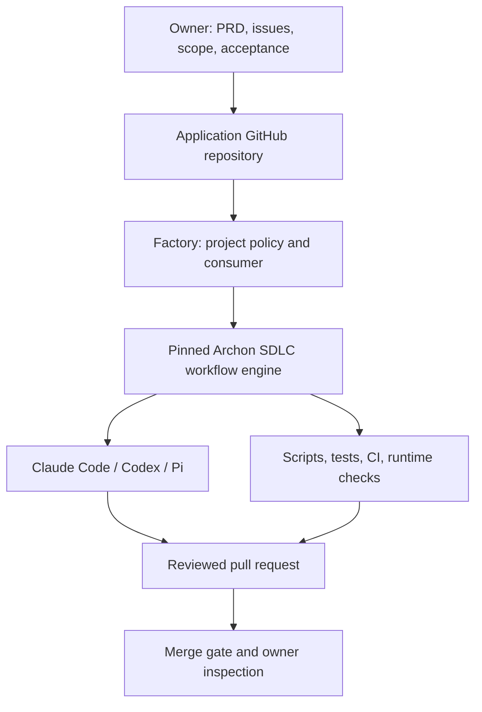
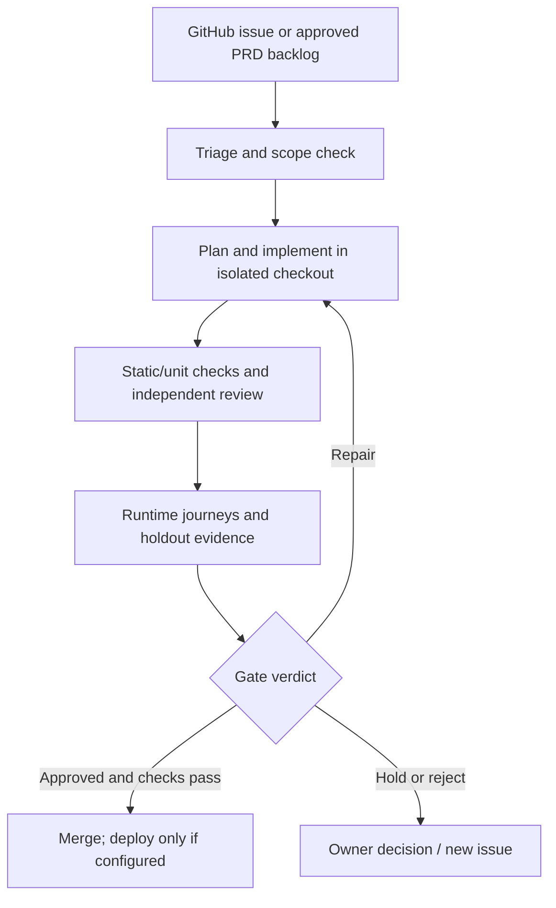

# Archon: what it does, how it works, and how to set it up

Parent note: [[medin software factory]]

> [!important] Scope of this note
> This describes the integration in `coleam00/ai-software-factory` at its pinned Archon commit `120f3e040f45c0ad88249601d846e414f4bf438b`. Archon's public documentation evolves; a feature on the current website is not automatically available in the factory's pinned revision. No live factory job has been run or validated in this environment.

## Mental model

**Archon is a workflow engine for AI coding work.** It reads YAML workflows, runs agent steps through configured providers, runs ordinary commands for deterministic checks, records results, and pauses for decisions. The AI Software Factory is a thin installation and project-policy layer that invokes Archon's shared SDLC workflows. Its target is a separate *application repository*, where GitHub issues and pull requests represent work. [Factory README](https://github.com/coleam00/ai-software-factory/blob/main/README.md) · [Factory derivation](https://github.com/coleam00/ai-software-factory/blob/main/docs/derivation.md) · [Pinned Archon README](https://github.com/coleam00/Archon/blob/120f3e040f45c0ad88249601d846e414f4bf438b/README.md)



| Layer | Owns | Boundary |
| --- | --- | --- |
| Herdr | Terminal panes, live interactive harness sessions, detach/reconnect and attention display | It does not govern Archon workflow nodes. |
| Claude Code, Codex, Pi | Agent execution and native account/configuration | A provider is selected by Archon's settings or workflow binding. |
| Hermes | Your separate harness | No documented provider adapter at the factory's pinned Archon revision. |
| Archon | Workflow graph, node scheduling, isolation/worktrees, agent dispatch, run state, approvals, CLI/console | It does not decide product taste or define the app's mission. |
| AI Software Factory | Installer, pinned Archon source, app-specific policy, validation inputs, thin CLI wrapper and optional schedule binding | It does not implement a second set of agent workflows. |
| Application repo and GitHub | Product code, PRD/issues, CI, PRs and merge target | This is where the factory operates. |

Herdr's own README describes a terminal runtime that owns agent processes without wrapping them. Archon's provider docs at the pinned revision list Claude Code, Codex and Pi as first-party choices and allow mixing them. An Archon run may be launched from a terminal in Herdr, but its child agents are managed and observed through Archon; a direct Herdr-pane integration is **not established** by the consulted documentation. [Herdr README](https://github.com/herdrdev/herdr/blob/master/README.md) · [Pinned provider guide](https://github.com/coleam00/Archon/blob/120f3e040f45c0ad88249601d846e414f4bf438b/packages/docs-web/src/content/docs/getting-started/ai-assistants.md)

## What actually happens during a run

Archon workflows are directed graphs. A node may ask an agent to plan, implement or review; run a shell/script check; loop with a bound; invoke another workflow; or wait for a human decision. Dependencies and conditions determine which nodes run next. Independent nodes can run in parallel. Repository runs normally use separate Git worktrees to isolate changes; a worktree is **not** a security sandbox. Archon stores run/node state, events and artifacts so a paused or detached run can be inspected and resumed. [Pinned Archon README](https://github.com/coleam00/Archon/blob/120f3e040f45c0ad88249601d846e414f4bf438b/README.md) · [Current concepts](https://archon.diy/getting-started/concepts/) · [Current architecture](https://archon.diy/reference/architecture/) · [Current approval guide](https://archon.diy/guides/approval-nodes/)



The factory's `archon-ship` takes an issue toward a reviewed PR. `archon-lifecycle` adds runtime/holdout checks, bounded repair, discoveries and merge/deployment steps. `archon-backlog` proposes ordered issues from a PRD. `archon-loop` and `archon-manager` are later scheduling workflows. Exact entries are declared in [the factory's pinned pack manifest](https://github.com/coleam00/ai-software-factory/blob/main/template/factory/pack.json); [the README](https://github.com/coleam00/ai-software-factory/blob/main/README.md) explains their intended use.

### Scope and limits

- Archon governs **the runs started through Archon**; your manual Herdr sessions remain yours to direct.
- Factory AI stages must go through the shared Archon SDLC pack. Editing the factory's Python wrapper to spawn coding agents directly would diverge from this design. [Factory derivation](https://github.com/coleam00/ai-software-factory/blob/main/docs/derivation.md)
- GitHub issues or your PRD supply the backlog. The factory does not choose a product vision. `MISSION.md` supplies scope and explicit exclusions; you inspect staging and file corrections as new work. [Factory README](https://github.com/coleam00/ai-software-factory/blob/main/README.md)
- Merge checks and reviews depend on the application's CI and configured gates. Deployment is project-specific: without a configured deploy command, health check and build identity, a successful merge does not deploy an app. [Factory README](https://github.com/coleam00/ai-software-factory/blob/main/README.md)
- The factory's first-hour guide says the current integration still needs live end-to-end validation; `doctor` checks installation and workflow availability, not successful provider sign-in or an actual issue-to-PR run. [First hour](https://github.com/coleam00/ai-software-factory/blob/main/docs/first-hour.md)

## Installation: exact factory route

**Choose one host environment first:** Windows native or WSL/Linux. Install and authenticate the CLI tools *in that same environment*. Windows and WSL have different home directories, credential stores and executable paths; a login in one is not automatically available in the other. This is an operational inference from Archon's documented config and provider paths. [Pinned configuration](https://github.com/coleam00/Archon/blob/120f3e040f45c0ad88249601d846e414f4bf438b/packages/docs-web/src/content/docs/reference/configuration.md) · [Pinned provider guide](https://github.com/coleam00/Archon/blob/120f3e040f45c0ad88249601d846e414f4bf438b/packages/docs-web/src/content/docs/getting-started/ai-assistants.md)

**Prerequisites:** Git, Python 3.10+, Bun, uv, GitHub CLI (`gh`) with `workflow` scope and Git push authentication, and at least one supported coding provider. Ensure the *application* has a GitHub remote. Authenticate `gh` with `gh auth login -s workflow`, then run `gh auth setup-git`; check `gh auth status` without printing secrets. [Factory README](https://github.com/coleam00/ai-software-factory/blob/main/README.md)

Keep the factory checkout *outside* the application repository. In the application's root, run (replace the placeholder with the actual checkout path):

```text
python <path-to-ai-software-factory>/bin/factory.py init
python factory/consumer.py doctor
python factory/consumer.py list
```

The first command copies the factory's consumer and templates into the application and installs its pinned Archon source. Specifically, the installer caches a detached, exact Archon commit under `~/.cache/factory/archon/<commit>`, runs `bun install --frozen-lockfile`, checks the source and writes consumer settings. The consumer invokes the **pinned Archon TypeScript CLI via Bun**, rather than a global `archon` binary. Consequently, separately installing the newest Archon executable is **not a prerequisite** for this factory route and may produce different behavior. The installer does not sign into providers, set models or turn on scheduling. [Factory installer](https://github.com/coleam00/ai-software-factory/blob/main/bin/install.py) · [Consumer](https://github.com/coleam00/ai-software-factory/blob/main/template/factory/consumer.py) · [Factory README](https://github.com/coleam00/ai-software-factory/blob/main/README.md)

### Provider and model configuration

Use Archon's native config. Global preferences live in `~/.archon/config.yaml`; project-specific overrides live in `<application>/.archon/config.yaml`. Environment and explicit run bindings can override these. Select at least one provider; start with one known working account, then add cross-provider tiers once a baseline run succeeds. Use exact model identifiers supported by the installed provider and account. [Pinned configuration reference](https://github.com/coleam00/Archon/blob/120f3e040f45c0ad88249601d846e414f4bf438b/packages/docs-web/src/content/docs/reference/configuration.md)

```yaml
# Illustrative project-level .archon/config.yaml; choose actual available models.
assistant: codex
assistants:
  codex:
    model: <your-supported-codex-model>
# Optional after single-provider validation:
# tiers:
#   small:  { provider: pi, model: <your-supported-pi-model> }
#   medium: { provider: codex, model: <your-supported-codex-model> }
#   large:  { provider: claude, model: <your-supported-claude-model> }
```

| Provider | Authentication and runtime behavior at pinned revision |
| --- | --- |
| Claude Code | Install and sign in to Claude Code in the chosen environment. Archon uses the Claude Agent SDK and the Claude executable; set its binary path when autodetection fails. |
| Codex | Install/sign in with `codex login`; Archon uses Codex `app-server` and can reuse its native login and config. |
| Pi | Sign in and configure Pi in the chosen environment; the bundled Archon adapter reads its Pi auth/settings. Confirm the selected backend and workflow capability before assigning it a gate-critical node. |
| Hermes | No documented adapter in the pinned provider guide; it remains available for your separate manual work in Herdr. |

Source: [Pinned AI assistants guide](https://github.com/coleam00/Archon/blob/120f3e040f45c0ad88249601d846e414f4bf438b/packages/docs-web/src/content/docs/getting-started/ai-assistants.md). Provider credentials must remain outside committed repository files.

### Product and validation configuration

The setup agent reads the *application* repo before drafting: `MISSION.md` (product definition and meaningful exclusions), `harness/END-TO-END.md` (two to five user journeys the existing app **already does**), and `.factory/holdout/HOLDOUT.md` (independent combined scenarios). For a PRD-only repo, planned behavior is the stated exception. If holdouts must be secret, keep the private evaluation copy out of builder-accessible checkouts. Configure actual static/unit commands, CI `required_checks`, runtime start/health/build-identity inputs, and test calibration from `factory/RUNTIME_HOST.md`. Protect governance paths in `harness/harness.config.json`. [Factory instructions](https://github.com/coleam00/ai-software-factory/blob/main/README.md) · [Runtime host](https://github.com/coleam00/ai-software-factory/blob/main/template/factory/RUNTIME_HOST.md)

## First supervised run: where the work begins and ends

For an **existing app**, create one small issue in its GitHub repo and run from that app's root:

```text
python factory/consumer.py run archon-ship --input target=https://github.com/OWNER/APP/issues/1 --detach --json
python factory/consumer.py status --all --json
python factory/consumer.py get <run-id> --json --events
```

`archon-ship` is the shorter issue-to-reviewed-PR route. For `archon-lifecycle`, first prepare the runtime host and scenario/holdout inputs, then use merge approval and preview-only discovery publication. Inspect the run evidence and PR; answer any explicit attention item. [Factory commands and first-hour guide](https://github.com/coleam00/ai-software-factory/blob/main/README.md) · [First hour](https://github.com/coleam00/ai-software-factory/blob/main/docs/first-hour.md)

For a **new app from a PRD**, place the PRD in that app repo, then run:

```text
python factory/consumer.py run archon-backlog --input prd=<path-to-PRD> --input publication=approve
```

Review the proposed issues before publication. The first issue must make a runnable skeleton with its start command, health/build-identity endpoints, tests and CI; wire the runtime host before its lifecycle run. [Factory README](https://github.com/coleam00/ai-software-factory/blob/main/README.md)

**Where you enter:** product intent, scope, initial PRD or issues, validation journeys and approval of consequential decisions. **Where Archon runs:** repeatable execution of the selected issue through agents, checks and review. **Where you return:** inspect the PR/run evidence and staging app; turn mismatches into new issues. Enable an Archon-backed schedule only after one issue succeeds under observation. [First hour](https://github.com/coleam00/ai-software-factory/blob/main/docs/first-hour.md)

## Generic first-run checklist (not the current workbench status)

- [ ] Pick the application repository and one execution environment (Windows native, WSL, or Linux server).
- [ ] Inventory Git, Python, Bun, uv, `gh`, CLI credentials and one provider **in that environment**.
- [ ] Clone the factory separately; run `init` from the application repository.
- [ ] Configure one provider and supported model tiers; run `doctor` and `list`.
- [ ] Define mission, existing journeys, holdout, checks, runtime host and CI rules.
- [ ] Run one small issue with `archon-ship`; examine actual cost, agent steps, PR, checks and run events.
- [ ] Validate the full lifecycle and staging behavior before considering schedules or mixed-provider routing.

## Windows operations: what this installation actually required

This section records the setup completed on 2026-10-23–24 for
`D:\workspace\personal\data-science-workbench`. It supplements the generic
installation path above. Commands are for **PowerShell on Windows** unless a
block says it runs inside the container. It does not claim that an Archon issue
run, PR, merge, deployment, or schedule has succeeded.

### 1. Keep the three checkouts and processes straight

| Component | This installation | Purpose |
| --- | --- | --- |
| Factory source | `D:\workspace\personal\software-factory-medin`, personal branch `emilio-alpha`; Cole's repository is the `upstream` remote | Versioned installer and project templates. Sync upstream into the personal branch through normal Git review; do not put local custom work on the upstream-tracking `main`. See [Windows factory fork setup](SETUP_ai-software-factory_on_Windows.md). |
| Application | `D:\workspace\personal\data-science-workbench`, currently on `dev` | The repo the factory acts on. Its installed `factory/`, `harness/`, mission, and policy files are project-specific and currently uncommitted. |
| Pinned Archon engine | `C:\Users\emili\.cache\factory\archon\120f3e040f45c0ad88249601d846e414f4bf438b` | Complete detached source checkout used by the Windows consumer. Do not edit its workflows or source in place. |
| Windows Archon CLI | Pinned `packages/cli/src/cli.ts` run with Bun | The CLI process the workbench consumer invokes. It reads Windows home/config and native harness logins. |
| Docker dashboard | `archon-dashboard`, image `archon:factory-120f3e0`, currently bound to `127.0.0.1:3000` | Optional browser UI and separate execution environment. It is **not** the process that `factory/consumer.py` calls on Windows. |
| Port | Separate hosted catalog/workflow product | Optional future integration, not needed to run the factory. The [Port integration research](2026-10-23_Port_Archon_Medin_AI_Software_Factory_Local_Integration_Runbook.md) is a proposal, not evidence of a live Port bridge. |

The Docker dashboard and Windows CLI can point at the same Supabase Postgres
database while resolving *different Archon users*, homes, provider subscriptions,
and model preferences. Logging in through the dashboard does not log in the
Windows CLI. The factory never reads Docker's `/.archon` volume just because the
dashboard is running.

### 2. Install the consumer in the application checkout

The factory installer must run **from the application repo**, even though its
script lives in the separate factory checkout. Check `git status` first. The
installer preserves personal project files, writes factory templates, backs up
changed factory files under `.factory/backup`, and writes the integration pin to
`.factory/consumer.json` at the Git common root. A failed dependency install may
leave those template files copied but the pin absent; this is why the first
attempt produced `Integration pin required` from `consumer.py doctor`.

```powershell
$Work = 'D:\workspace\personal\data-science-workbench'
$Factory = 'D:\workspace\personal\software-factory-medin'
$Bun = 'C:\Users\emili\.cache\factory\bun\bun-v1.4.4\bun-windows-x64\bun.exe'
Set-Location $Work
git status --short
& $Bun --version
python (Join-Path $Factory 'bin\factory.py') init --bun $Bun
Test-Path .\.factory\consumer.json
python .\factory\consumer.py list
```

The first attempt used ambient Bun `1.0.36-canary.40` and failed at
`bun install --frozen-lockfile` with `lockfile had changes, but lockfile is
frozen`. Using the isolated Bun `1.4.4` executable completed the pin without
altering the application's Python version. If the Bun path changes, supply a
tested Bun executable with `--bun`; verify the resulting pin and workflow list.
Do not use `--scaffold-only` as evidence of engine readiness.

The normal consumer checks are `python .\factory\consumer.py doctor` and
`python .\factory\consumer.py list`. In a later check, `list` found 21 shared
workflows, but `consumer.py doctor` gave no output in two bounded attempts and
was terminated. It had passed immediately after the original install, so the
later hang remains unexplained. Do not leave it running indefinitely or report
that later check as a pass. The direct, pinned Archon doctor below completed and
passed; it verifies Archon's environment, not every consumer-specific check.

### 3. Use the same pinned CLI for Windows setup and diagnosis

Read the source and Bun paths from the installed consumer settings instead of
guessing which `archon` binary is on `PATH`:

```powershell
Set-Location 'D:\workspace\personal\data-science-workbench'
$Install = Get-Content .\.factory\consumer.json -Raw | ConvertFrom-Json
$ArchonCli = Join-Path $Install.source 'packages\cli\src\cli.ts'
& $Install.bun $ArchonCli doctor
& $Install.bun $ArchonCli ai tier list --json
& $Install.bun $ArchonCli ai alias list --json
& $Install.bun $ArchonCli ai list
```

As of 2026-10-24 the direct doctor exited 0: config valid, Codex native login
usable, Postgres reachable, one Cloudflare Workers AI key usable, 21 workflows
and 34 commands loaded, and `archon-cli` installed. Its `gh CLI: GitHub not
configured (no GITHUB_TOKEN)` line was a **skip**, not a failure; Windows
`gh auth status` separately showed a logged-in account with `repo` and
`workflow` scopes. Confirm GitHub behavior in a supervised run before depending
on the skip. The `Claude binary`/`Codex binary` development-mode lines and
unregistered folder-project line were also skips. The message about stripping
keys from a target `.env` refers to Bun/Archon process environment sanitation;
it does not prove the project `.env` file was changed.

### 4. Database: why Supabase appeared in the setup

The factory does **not** require its own database. Archon stores users, projects,
runs, credentials, and state. Pinned Archon defaults to SQLite at
`~/.archon/archon.db` when `DATABASE_URL` is absent; our Docker dashboard and
Windows CLI were configured for the same Supabase Postgres project instead.
The pooler host supplied for this setup was
`aws-0-ca-central-1.pooler.supabase.com:5432`, database `postgres`. Keep the
password, full connection URL, service-role token, and TLS material in private
environment/configuration locations, never in these notes or Git.

The pinned Archon source has `migrations/000_combined.sql`. Its Postgres adapter
applies that idempotent schema automatically at startup; the SQL file from an
older video is not a prerequisite for this pinned revision. A new database
schema or dedicated role can be used only if the connection and `search_path`
grant the migration permissions it needs. `archon doctor` reported Postgres
reachable and its schema present in this installation. See the pinned
[database reference](https://github.com/coleam00/Archon/blob/120f3e040f45c0ad88249601d846e414f4bf438b/packages/docs-web/src/content/docs/reference/database.md).

The native CLI uses `C:\Users\emili\.archon\.env` and
`C:\Users\emili\.archon\config.yaml`; the dashboard gets its environment from
its container launch and persists home data in Docker volumes. Sharing a DB
does **not** make dashboard-only OAuth sessions or user-scoped model tiers
appear under the CLI's identity. Treat both processes as separately configured.

### 5. Dashboard: launch, folders, and GitHub login

The running `archon-dashboard` container has image `archon:factory-120f3e0`,
host port `127.0.0.1:3000`, persistent volumes at `/.archon` and
`/home/appuser`, and a bind mount from the workbench to
`/projects/data-science-workbench`. The container has `uv 0.13.5` and
`python3 3.13.5`; the command `python` is not present. Inspect its mounts and
status before changing or recreating it:

```powershell
$Docker = 'C:\Program Files\Docker\Docker\resources\bin\docker.exe'
& $Docker ps --filter 'name=archon-dashboard'
& $Docker inspect archon-dashboard --format '{{json .Mounts}}'
& $Docker start archon-dashboard   # only if it is stopped
```

Open `http://127.0.0.1:3000`. When adding the workbench as a **local path** in
the dashboard, enter `/projects/data-science-workbench`, the path visible
*inside the container*. Entering `D:\workspace\personal\data-science-workbench`
caused the observed `/app/packages/server/D:\...` Git-root error because the
Linux process cannot resolve a Windows drive path. A new local project needs
its own bind mount and a corresponding container path; a dashboard restart
alone cannot expose an unmapped host folder. The existing container was not
created by the stock `docker-compose.yml` in the pinned source, so inspect its
live configuration before attempting a Compose recreation.

For the dashboard's own GitHub access, run this from **Windows PowerShell**:

```powershell
& $Docker exec -it -u appuser archon-dashboard gh auth login --hostname github.com --git-protocol https --scopes workflow
& $Docker exec -u appuser archon-dashboard gh auth status
```

If you are already at a `/bin/sh` prompt *inside* the container, run only
`gh auth login ...`; PowerShell's leading `&` and Windows path are shell syntax
errors there. Copy the fresh device code and open
`https://github.com/login/device` manually on the Windows browser. Container
`xdg-open` and clipboard helpers may be absent; a stale code is rejected.
GitHub CLI authentication in Docker is separate from Windows `gh auth status`.

### 6. Providers, subscriptions, and models in the correct environment

In the dashboard version observed, **Settings** started at Model Tiers, Model
Aliases, Defaults, System, and Alerts; provider connections appeared in the
**Pi** backend section rather than an “Agents” menu. That backend
section can connect Anthropic and OpenAI subscriptions and a Cloudflare Workers
AI API token. The Cloudflare token list is at
<https://dash.cloudflare.com/profile/api-tokens>; tokens may be shown only once
in full. Use a scoped Workers AI token and keep it out of URLs, shell history,
the repository, and this note. Browser OAuth callbacks are one-time data; a
failed redirect does not prove the credential was saved, so verify the UI's
connected status or CLI metadata. A ChatGPT or Claude subscription is distinct
from an API key and must be connected through that harness's supported login.

The Windows CLI was configured separately. `codex login status` and
`claude auth status` confirmed native subscriptions; Pi has Anthropic and
OpenAI OAuth entries in its Windows user auth store. Archon `ai list` currently
shows a Cloudflare Workers AI key. It does not list the Codex native login,
which `archon doctor` checks separately. To connect another Archon-managed key,
use `ai key set <vendor>` with the CLI's masked prompt or stdin, never a token
as a command argument. Do not copy Docker's private auth files to Windows.

The installed Windows CLI currently resolves these install-scoped settings:

| Binding | Provider/model | Effort |
| --- | --- | --- |
| Default assistant | `codex` | — |
| `small` | `codex/gpt-6-luna` | `high` |
| `medium` | `codex/gpt-6-luna` | `xhigh` |
| `large` | `codex/gpt-6-sol` | `medium` |
| `@gpt-6-luna` | `codex/gpt-6-luna` | `xhigh` |
| `@gpt-6-sol` | `codex/gpt-6-sol` | `medium` |

Use `& $Install.bun $ArchonCli ai default codex`, `ai tier set`, and
`ai alias set` to change these, then reread `ai tier list --json` and
`ai alias list --json`. The CLI's built-in model defaults may still show
`gpt-5.6-*`; the **effective** entries above are the configured `gpt-6-*`
models. Install-scoped config lives in `~/.archon/config.yaml`; `--scope user`
writes a per-user database preference that can differ between dashboard and
CLI identities. A new run captures its resolved settings at launch; editing
tiers does not retarget an existing run.

### 7. Install the Archon skill for all three coding harnesses

The pinned `archon skill install .` command installs nine Markdown files under
each of `.agents/skills/archon-cli/` and `.claude/skills/archon-cli/` in the
application repo. It removes old `archon`/`manage-run` roots and overwrites
existing `archon-cli` skill files, so inspect those paths before reinstalling.
This solved the sole failing check in the direct Archon doctor:

```powershell
Set-Location 'D:\workspace\personal\data-science-workbench'
& $Install.bun $ArchonCli skill install .
& $Install.bun $ArchonCli doctor
```

Pi 1.4.0 auto-discovers project `.agents/skills`, and Pi's own resource loader
found this `archon-cli` skill with **project** scope and no diagnostics. A third
copy under `.pi/skills` would create a name collision. Restart open Codex,
Claude Code, and Pi sessions to load the newly installed project skill.

### 8. Python and `uv` belong to the execution host's app commands

The dashboard image did not originally include `uv`; it is now installed in
the running container. Its `python3` is 3.13.5 and there is no `python`
alias. Archon itself and the workbench application are separate programs:
Archon's Python does not have to match a `requires-python` declaration in the
workbench's `pyproject.toml`. When a workflow runs a workbench check, the
*execution host* must be able to run that exact check with a compatible
workbench environment. Use `uv` to obtain/manage the app interpreter where
needed, or adjust the project's own version constraint deliberately; do not
alter Archon's runtime solely to mirror it. The Windows factory consumer uses
the Windows app toolchain, not Docker's Python, unless a run is explicitly
launched inside Docker.

### 9. Recovery and remaining work

| Symptom | Check or recovery |
| --- | --- |
| `lockfile had changes, but lockfile is frozen` | Check `bun --version`/`Get-Command bun -All`; rerun `init --bun <tested-Bun-path>`. The first failed init may already have copied templates. |
| `Integration pin required` | Check `.factory/consumer.json` at the Git common root; finish `init` before `consumer.py doctor`. |
| An unexpected VS Code window or `[main ...]` logs appear | These are VS Code process logs, not Archon output. The cause of the earlier launch was not established. Check command resolution with `Get-Command python,bun,code -All`; do not infer factory success from that window. |
| `consumer.py doctor` gives no output for an extended period | Bound the call and terminate it; verify no child process remains. Run the direct pinned Archon doctor to isolate Archon health, and investigate the consumer hang separately. |
| Dashboard rejects `D:\...` local path | Confirm the bind mount with `docker inspect`; use `/projects/data-science-workbench` in the UI. |
| `& ...docker.exe` fails at `/bin/sh` | Exit the container shell and run the full command in PowerShell, or use only the Linux-side `gh` command in the container. |
| Device code rejected or browser did not open | Start a fresh `gh auth login`, manually browse to the device page, and enter the current code before it expires. |
| Dashboard shows connected providers but Windows CLI does not | Check native Windows harness login and `archon ai list`/`doctor` under the Windows user; dashboard and CLI homes/identities are separate. |
| `archon-cli` skill missing | Run the pinned `skill install .` in the application root, then direct `doctor`; Pi consumes the `.agents` copy. |

The application still needs a reviewed `MISSION.md`, real workbench user
journeys and holdouts, check commands, runtime host, CI job names, protected
paths, and one **supervised** small issue run. Current evidence proves local
installation and direct Archon health, not the issue-to-PR lifecycle. Do not
enable `archon-loop`, `archon-manager`, an OS timer, or unattended merge until
that run and its gates are observed. Port remains a separate optional follow-up.

## Source index

- [AI Software Factory README and installation instructions](https://github.com/coleam00/ai-software-factory/blob/main/README.md)
- [Factory first hour](https://github.com/coleam00/ai-software-factory/blob/main/docs/first-hour.md) · [pinned pack manifest](https://github.com/coleam00/ai-software-factory/blob/main/template/factory/pack.json)
- [Factory installer](https://github.com/coleam00/ai-software-factory/blob/main/bin/install.py) · [consumer](https://github.com/coleam00/ai-software-factory/blob/main/template/factory/consumer.py)
- [Pinned Archon installation guide](https://github.com/coleam00/Archon/blob/120f3e040f45c0ad88249601d846e414f4bf438b/packages/docs-web/src/content/docs/getting-started/installation.md)
- [Pinned provider guide](https://github.com/coleam00/Archon/blob/120f3e040f45c0ad88249601d846e414f4bf438b/packages/docs-web/src/content/docs/getting-started/ai-assistants.md)
- [Pinned configuration reference](https://github.com/coleam00/Archon/blob/120f3e040f45c0ad88249601d846e414f4bf438b/packages/docs-web/src/content/docs/reference/configuration.md) · [pinned CLI reference](https://github.com/coleam00/Archon/blob/120f3e040f45c0ad88249601d846e414f4bf438b/packages/docs-web/src/content/docs/reference/cli.md)
- [Current Archon concepts](https://archon.diy/getting-started/concepts/) · [architecture](https://archon.diy/reference/architecture/) · [approval nodes](https://archon.diy/guides/approval-nodes/) (check against pinned revision before relying on newer features)
- [Herdr README](https://github.com/herdrdev/herdr/blob/master/README.md)
